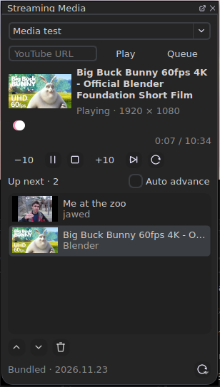

# Streaming Media Source for OBS

A standalone native OBS source for browser-free YouTube playback. Paste a
public YouTube video URL into **Sources → Streaming Media (YouTube)**, or
use the playback dock to import an entire public YouTube playlist.
The original URL, not an expiring media URL, is stored in scene settings.
Playback uses OBS's existing FFmpeg media engine; there is no browser,
desktop capture, listening port, or full-video download.



*Version 0.5.1 in OBS 32.2 with the Colorway Fluffy Dark theme, using a disposable demo scene.*

[Get started](#install-a-local-test-package) · [Playback dock](#playback-dock-02) · [Import playlists](#import-youtube-playlists-060) · [WebSocket requests](#websocket-video-requests-03) · [Verification](#verification) · [Troubleshooting](#troubleshooting)

> **Development preview (0.6.0).** Linux x86_64 and native OBS 32.2 are the current
> locally exercised target. Public release packages are not available.
> [Build checks](https://github.com/myrqyry/streaming-media-source/actions) · [Release readiness](RELEASE_CHECKLIST.md) · [Changelog](CHANGELOG.md)

## Requirements

- OBS Studio 32.x, native Linux installation (development/verification target:
  OBS 32.2.0, libobs 32.0.1 headers, Qt 6.4.2).
- The bundled Linux x86_64 package includes the standalone yt-dlp
  extractor and Deno JavaScript runtime. No separate Python, Node,
  yt-dlp, curl executable or PATH configuration is required.
- Source-only builds without the bundle automatically discover a complete
  yt-dlp + Deno or Node installation on PATH, in ~/.local/bin or in the
  existing NVM layout. The same Qt HTTPS rendition validation is used.
- CMake and Qt6 Core/Widgets/Network and libobs/frontend API development
  headers for building.

## Install a local test package

First generate the Linux x86_64 bundled archive using the [build and install](#build-and-install)
instructions below. From the directory containing the archive and its checksum,
verify the archive, close OBS, and extract it into the per-user plugins directory:

```sh
sha256sum -c streaming-media-source-0.6.0-linux-x86_64-bundled.tar.gz.sha256
mkdir -p "$HOME/.config/obs-studio/plugins"
tar -xzf streaming-media-source-0.6.0-linux-x86_64-bundled.tar.gz \
  -C "$HOME/.config/obs-studio/plugins"
```

Restart OBS, add **Streaming Media (YouTube)**, and open **Docks →
Streaming Media**. The archive contains the plugin, extractor, Deno and
runtime notices. No separate runtime setup or system-wide installation is
required. Public binary releases are not yet available.

## Build and install

```sh
# Maintainers: prepare verified upstream runtime executables (Python 3.11+).
python3 scripts/prepare-runtime.py --output build/bundle/data/runtime --cache build/runtime-downloads
cmake -S . -B build -DCMAKE_BUILD_TYPE=Release \
  -DSTREAMING_MEDIA_RUNTIME_DIR="$PWD/build/bundle/data/runtime"
cmake --build build -j2
ctest --test-dir build --output-on-failure
cmake --install build --prefix "$HOME/.config/obs-studio/plugins/obs-streaming-media"
```

The bundle is installed under the module's own `data/runtime/` directory.
It is preferred over system tools. For a source-only development build,
configure with `-DSTREAMING_MEDIA_RUNTIME_DIR=` and supply an existing
yt-dlp plus supported JavaScript engine. The install is local; no packages
are installed globally. Runtime pins are intentionally explicit and
downloaded assets are checked against recorded upstream SHA-256 digests.
The dock's media engine menu offers **Check for extractor updates** and
**Use bundled extractor**. Updates are fetched only on request from the
official stable yt-dlp release, verified against the release asset SHA-256
and size, and version-checked before activation. The updated executable
is stored in the OBS plugin configuration directory; the original bundle
remains untouched. The next resolution uses the new engine without an OBS
restart. Use the bundled extractor to roll back. Deno remains pinned.
See [third-party runtime notices](third-party/README.md) and the release
checklist before distributing binaries.

To generate a local package after the build, use:

```sh
cpack --config build/CPackConfig.cmake -B build/packages
```

CPack produces a compressed archive and SHA-256 file. The system-runtime
build produces a separately named archive without the bundled executables.
Do not upload bundled archives until the redistribution review is complete.

Restart OBS when convenient. In source properties, paste a YouTube URL and
select maximum resolution, hardware decoding, playback speed and network
buffer. The source has OBS's normal media controls. Restart resolves a
fresh media URL; expired URLs and extraction errors can require a fresh resolution.
Quality is a cap, not a guarantee: when separate renditions are unavailable,
the resolver may select a lower-quality combined video/audio stream.

## Playback dock (0.2)

Open **Docks → Streaming Media**. Choose an existing Streaming Media source
by name; the picker follows its stable UUID, not the current scene item name.
Paste a video link and select Play or Queue. The current thumbnail, title,
actual decoded resolution, state, timeline and transport controls are shown
without a browser. The queue is stored per source in the scene collection.
Double-click an item to play it, or use the arrows and remove button.
Auto advance is off by default; when enabled it advances only after an
observed natural VOD end. Stop leaves upcoming entries intact. A premature
decoder end or error preserves the queue and surfaces Retry, which resolves
a fresh URL. Enable or disable automatic recovery in source properties
(**Recover interrupted playback**, enabled by default).

### Visual playlists (0.4.1)

Upcoming videos show a thumbnail, title and channel name, with full
metadata and original URL in the tooltip. Drag rows to reorder them,
or use the existing move buttons. Reordering is applied by the source;
a drag is discarded if the selected source or queue changed mid-gesture.

Public YouTube oEmbed metadata and fixed-host thumbnail requests are
asynchronous, bounded and cached in memory by video ID. Only visible
rows are requested, one at a time; unavailable metadata falls back to
the video ID without blocking playback. The delegate inherits the OBS
theme and selection palette. Queue entries remain original URLs in
scene settings.

### Import YouTube playlists (0.6.0)

In YouTube, copy a public playlist link (for example,
`https://www.youtube.com/playlist?list=...`). Open **Docks → Streaming Media**,
select the source you want to control, and paste the link into the existing URL field.

Choose the action that matches what you want to happen:

- **Queue** appends available videos in playlist order, preserving the
  current video and the existing auto-advance setting.
- **Play** selects the first available video, prepends the rest ahead of
  existing upcoming videos, and enables Auto advance. Existing queued
  entries are never evicted.
- A video URL with a supported playlist ID offers **This video** or
  **Entire playlist**. Dynamic mixes and authenticated playlists are
  outside the supported scope.
- An independent asynchronous yt-dlp flat-playlist request enumerates
  metadata without resolving each item's actual media streams. It examines
  at most 101 entries per import, with a 45-second deadline and 4 MiB
  response limit. The queue still holds at most 100 upcoming videos.
- Cancel while importing to leave playback and queue unchanged. A source
  change cancels an in-flight enumeration; the resulting batch is applied
  to its original source, never the newly selected source.
- Known inaccessible entries are skipped; entries unavailable only at
  playback time may still fail later. The dock reports the number actually
  queued and capacity limits.
- Titles, channel names and known durations populate the in-memory metadata
  cache. Thumbnails still use the existing fixed-host fetcher. The queue
  duration summary covers upcoming videos, excludes the currently playing
  video, and identifies entries with unknown durations. URLs survive an OBS
  restart, but imported duration metadata is session-only. Reimporting a
  playlist adds entries; it is not a metadata-refresh operation.

The queue limit is shared with existing individual videos. Large playlists are
truncated rather than paginated; importing the same playlist again may add
duplicates. Shuffle and repeat are not yet implemented.

**Verified in 0.6.0:** the bundled engine imported a public Blender uploads
playlist with an empty PATH and a fresh HOME. Queue added 99 entries alongside
one existing entry without interrupting playback. Play selected the first video,
preserved the existing queue, enabled automatic advancement, and restored actual
video and mixer audio. Cancellation and the normal playback regression also passed.

### Playback recovery (0.4)

After playback has started, an unexpected decoder stop, early end or error
schedules a fresh resolution. A selected video has at most two automatic
attempts, with one- and three-second backoff delays. A recovered VOD seeks
back to its last observed playback position before admitting picture and
audio; live streams, where supported, reconnect at the live position.
A failed recovery resolution uses the remaining retry budget. Initial
extraction errors do not automatically retry. Stop, manual restart and
selecting another video cancel pending recovery; the upcoming queue is
not consumed by an interruption. The Retry button still restarts from
the beginning and grants a new retry budget.

Recovery is driven by decoder state changes; silent stalls without a
terminal state are not yet detected. A recovery may fail if the network
or provider remains unavailable.

### Theme integration (0.3.1)

The dock uses OBS's native media and utility icon classes, theme-provided
typography, inherited widget palettes and style metrics. Its icons refresh
on OBS theme changes and Qt style/palette/font changes; playback polling
does not overwrite theme icons. Preview dimensions adapt to font size and
dock width, and the cached thumbnail is scaled at the device pixel ratio.
Ten-second seek buttons use explicit −10/+10 labels rather than ambiguous
playlist icons. The Qt fallback supports styles that lack OBS icon classes.

The deterministic dock-theme-test checks live stylesheet icon replacement
and responsive preview sizing without a live video. The actual dock has also
been visually inspected in a disposable OBS 32.2 profile with Colorway Fluffy
Dark. This does not qualify every third-party theme or display scale.

## WebSocket video requests (0.3)

Uses OBS WebSocket 5.x's existing authenticated server and
`CallVendorRequest`, vendor name `streaming-media`. No additional server,
port, or automatic WebSocket configuration changes. OBS WebSocket API
headers are needed at build time; local playback still works if the runtime
WebSocket module is absent.

Enable **Accept WebSocket video requests** in the target source properties.
This is off by default. Only authenticated, trusted integrations should have
OBS WebSocket credentials. Do not expose the OBS control socket to viewers:
a chat bot should enforce its own request permissions, rate limits and
moderation before sending requests. Requests only append to the upcoming
queue. If auto-advance is enabled, those entries can subsequently play.

| Vendor request | Request data | Response data |
| --- | --- | --- |
| ListSources | none | status, sources (sourceUuid, sourceName, acceptRequests) |
| SubmitVideo | sourceUuid, url | status, requestId if pending |
| GetRequestStatus | sourceUuid, requestId | status |
| GetQueue | sourceUuid | status, currentUrl, items, acceptRequests, autoAdvance |

Example using an already authenticated obs-websocket-js client:

```js
const { responseData: sources } = await obs.call("CallVendorRequest", {
  vendorName: "streaming-media", requestType: "ListSources",
});
const target = sources.sources.find(s => s.acceptRequests);
if (!target) throw new Error("No enabled Streaming Media source");
const { responseData: receipt } = await obs.call("CallVendorRequest", {
  vendorName: "streaming-media", requestType: "SubmitVideo",
  requestData: { sourceUuid: target.sourceUuid, url: "https://youtu.be/jNQXAC9IVRw" },
});
```

A `pending` receipt means the source accepted the command for processing;
poll `GetRequestStatus` using its requestId and the same sourceUuid to confirm
`queued`, `duplicate`, `queue_full`, `disabled` or `invalid_url`.
Immediate failures also include `busy`, `source_not_found`, and
`unavailable`. An expired or unknown receipt returns `unknown_request`.
Receipts are bounded in memory and not persisted. Queue entries are persisted
as before. Canonical video IDs deduplicate watch/short links and exclude the
current video; the remote interface does not accept arbitrary media URLs or
commands to replace what is playing. Queue limit: 100; pending commands: 64.

`tests/websocket-smoke.py` exercises a disposable OBS profile with an empty
Streaming Media source and a password-protected WebSocket server. Pass the
isolated profile's obs-websocket config.json path; never use the active
production profile for this smoke (it changes that source's test settings).

### Playback lock safety (0.3.2)

The private decoder's audio capture callback does not call the parent
source. It copies PCM and its original timestamp into a preallocated,
bounded handoff queue. An independent consumer delivers the audio outside
the decoder and queue locks. Source changes invalidate pending PCM. Video
dimensions are sampled on the video tick and exposed atomically; the dock
reads the snapshot rather than acquiring nested source filter locks.
Decoder updates must be applied before accepting new playback output.
This removes the lock inversion identified in a production freeze stack.

## Architecture

The bundled or system yt-dlp runs on a cancellable worker with explicit time/size bounds and without
loading user config. The resolver uses Qt HTTPS with bounded response sizes, deadlines and validated googlevideo redirects (no external curl process). It validates reachable video and audio
renditions before choosing them, preserves signed URLs verbatim, and for
supported VOD HLS playlists saves only the validated playlist metadata in a
private temporary directory. FFmpeg reads the segments on demand. A private
OBS Media Source renders video and forwards audio into the parent source;
the child's own output mixer is disabled to avoid double routing.

## Verification

The [Linux CI workflow](.github/workflows/ci.yml) uses a pinned OBS 32.2.0
SDK and the matching obs-websocket API header. It runs the deterministic
native CTest suite (at least nine tests, no skips), checks README links,
and validates a module-only Linux install archive and checksum.
The CI path deliberately does not download or bundle yt-dlp/Deno, run live
YouTube playback, or upload release binaries.

| Target | Verification boundary |
| --- | --- |
| Linux x86_64 / OBS 32.2 / Qt 6.4.2 | Local native tests, isolated real playback and bundled package smoke |
| Ubuntu 24.04 / pinned OBS 32.2 SDK | Local CI driver passed; hosted run blocked by Actions budget |
| Windows, macOS, Flatpak, other OBS majors | Not qualified |

The first [hosted run](https://github.com/myrqyry/streaming-media-source/actions/runs/45404314210)
was prevented from starting by the GitHub Actions budget; no build or test
steps executed. See the [CI guide](docs/ci.md) for local reproduction. The optional real
playback smoke below is deliberately separate from deterministic CI.


```sh
xvfb-run -a timeout 200 build/obs-youtube-smoke \
  "$PWD/build/obs-streaming-media.so" \
  'https://www.youtube.com/watch?v=aqz-KE-bpKQ'
```

For a staged bundled build, set `SMOKE_MODULE_DATA` to the staged
`data/` directory and point the test at the staged module binary.
The test can run with an empty PATH and a fresh HOME to verify runtime
independence.

This network-dependent isolated libobs test checks actual rendered pixels,
nonzero source and mixed audio, pause, seek and resume; actual Qt widget thumbnail, queue editing, next playback, natural EOF auto advance, stop preservation and teardown. It is intentionally
separate from the deterministic CTest suite. To exercise recovery, run
the same command with `SMOKE_RECOVERY=1` in the environment: this stops
the actual private FFmpeg decoder mid-video, checks fresh resolution,
position and mixer audio recovery, and cancels a second scheduled retry
using the parent Stop action. This is an injected decoder interruption,
not a simulated network outage. Set `SMOKE_PLAYLIST_IMPORT=1` to exercise
real public playlist enumeration, cancellation, append while playing,
capacity limits, metadata, Play and source teardown. Set
`SMOKE_PLAYLIST_DRAG=1` for the
real X11 drag-reorder test in the normal playback smoke (requires Python
Xlib). It validates that public titles and thumbnails load and that the
actual persisted queue order changes. Test logs from FFmpeg may contain
temporary signed media URLs; redact before sharing.

## Troubleshooting

| Symptom | First check |
| --- | --- |
| Source is missing | Confirm native OBS 32.x and the module under `plugins/obs-streaming-media/bin/64bit/`. Restart OBS after installation. |
| Media engine missing | Use the bundled package, or install a compatible yt-dlp and Deno/Node for the system-runtime build. |
| Video no longer resolves | Check for extractor updates in the dock, then retry. |
| Update breaks resolution | Choose Use bundled extractor in the engine menu and retry. |
| Playback stalls or has rendering issues | Try a lower resolution or disable hardware decoding; include the OBS/plugin versions and redacted logs in a bug report. |
| Playlist import adds fewer videos than expected | Check the 100-entry upcoming queue limit, inaccessible entries and the 101-entry enumeration bound. |
| Playlist import cannot start | Use a supported public playlist link, check the media engine, or try the individual video. |
| Queue duration is incomplete | Some entries lack known durations; imported durations are not restored after restarting OBS. |
| Remote requests are rejected | Enable Accept WebSocket video requests on the intended source and use its UUID. |

FFmpeg and OBS logs may contain expiring signed media URLs. Redact them,
credentials, private scene information and local paths before sharing.

## Scope and limits

The intended experience is direct media playback without the web player's
ad UI. Ads, in-video sponsor segments, DRM, private/member-only videos,
live streams and platform restrictions are not guaranteed to be removed or
supported. No browser-cookie import, login, proxy, token-provider integration
or automatic circumvention of unavailable media. Use content you have
permission to play or rebroadcast. YouTube extraction can change independently
of the plugin. Current verified scope is public VOD, native Linux OBS,
software decoding; hardware decoding is an option but is not yet qualified.

See ACTIVE_WORK.md for exact runtime evidence and remaining work.

## Reference

- https://github.com/yt-dlp/yt-dlp
- https://github.com/yt-dlp/yt-dlp/wiki/EJS
- https://github.com/yt-dlp/yt-dlp/wiki/PO-Token-Guide
- https://github.com/obsproject/obs-studio
