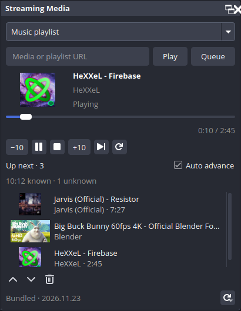

# Streaming Media Source for OBS

**Play internet video and audio directly in OBS, without a browser source.**

One native plugin, two source types, a shared playback dock. Queue links from different services, import collections, and route audio through the OBS mixer.

<p align="center">
  
  
</p>

<p align="center"><sub>Streaming Media and Streaming Audio in OBS 32.2, using the built-in Yami dark theme and real mixed-provider queues.</sub></p>

[Quick start](#quick-start) · [Providers](#providers) · [Playlists](#playlists) · [Installation](#installation) · [Compatibility](#compatibility) · [Documentation](#documentation)

> **Development preview · 0.6.0** — source builds and local test packages are available; no public binary release yet. [Build checks](https://github.com/myrqyry/streaming-media-source/actions) · [Changelog](CHANGELOG.md)

## Providers

| Service | Streaming Media (video + audio) | Streaming Audio (audio only) | Collection import |
| --- | --- | --- | --- |
| YouTube | Public videos | Dedicated audio streams | Public playlists, both sources |
| Twitch | Live channels, clips, completed VODs | — | — |
| Kick | Live channels, clips, completed VODs | — | — |
| TikTok | Public video posts, initial support | — | — |
| SoundCloud | — | Public MP3 and supported AAC HLS tracks | Public sets, audio only |
| Bandcamp | — | Public MP3 tracks | Public albums, audio only |

All listed individual-media paths have played real video and/or audio in isolated Linux OBS 32.2 tests. SoundCloud set import can skip unsupported URLs or encounter unplayable tracks; full collection playback remains unqualified. TikTok buffers a complete clip (known size, up to 64 MiB) before playback; other providers stream on demand. Spotify is not supported.

See [provider details](docs/providers.md) for accepted URL forms, seeking behavior and verification limits.

## Quick start

1. [Install the plugin and media engine](#installation), then start OBS.
2. Add **Sources → + → Streaming Media** for video or **Streaming Audio** for music.
3. Open **Docks → Streaming Media** and select the source by name.
4. Paste a public media link and choose **Play** or **Queue**.
5. Enable **Auto advance** to play the next queued item after a natural ending.

The dock includes native media controls, timeline, resolution, metadata, generated video previews, track artwork, drag-to-reorder queue rows and OBS theme integration. Audio-only sources select dedicated audio renditions and produce no video frames. Each source has its own queue and normal OBS mixer routing.

## Playlists

Mix supported services **in the same source's queue**. A video queue can contain YouTube, Twitch, Kick and TikTok; an audio queue can contain YouTube, SoundCloud and Bandcamp.

- **Queue** appends links or collection entries without interrupting playback.
- **Play** starts an individual item, or starts the first accepted collection entry and prepends the rest ahead of the existing queue.
- Import public YouTube playlists, SoundCloud sets and Bandcamp albums using the same URL field. Collection support depends on the selected source.
- Upcoming entries persist in the scene collection; artwork and metadata are cached for the session. Stop preserves the queue.
- Automatic advancement follows natural endings, not errors. Live channels need manual advancement. A failed resolution surfaces Retry rather than silently discarding an entry.

Up to 100 upcoming entries per source. Imports can be cancelled and respect existing queue capacity. Shuffle and repeat are not implemented. See the [playback and queue guide](docs/playback.md).

## Installation

No public release binaries have been published. Build a local package with the matching OBS SDK:

```sh
# Linux OBS 32 example; install development dependencies first.
python3 scripts/prepare-runtime.py --output build/bundle/data/runtime --cache build/runtime-downloads
cmake -S . -B build -DCMAKE_BUILD_TYPE=Release \
  -DSTREAMING_MEDIA_RUNTIME_DIR="$PWD/build/bundle/data/runtime"
cmake --build build -j2
ctest --test-dir build --output-on-failure
# Close OBS before installing.
cmake --install build --prefix "${XDG_CONFIG_HOME:-$HOME/.config}/obs-studio/plugins/obs-streaming-media"
```

The bundled Linux x86_64 runtime includes yt-dlp and Deno. Module-only builds can use a complete manually installed runtime or discover existing system tools. The dock provides runtime setup and, for the supported Linux bundle, opt-in extractor updates and rollback.

- [Build, install paths and local packaging](docs/build-install.md)
- [Manual media engine setup and verified upstream downloads](docs/runtime-setup.md)

## Compatibility

| Platform | OBS 32.2.0 SDK | OBS 33.0.3 SDK |
| --- | --- | --- |
| Linux x86_64 | Passed | Passed |
| Windows x64 | Passed | Passed |
| macOS Apple Silicon | Passed | Passed |
| macOS Intel | Passed | Passed |

**Build, test and packaging baseline:** all eight jobs passed on the merged video/audio baseline in [CI run 45542976014](https://github.com/myrqyry/streaming-media-source/actions/runs/45542976014). The newer TikTok changes passed nine local regression tests and the owner's real playback smoke on Linux OBS 32.2; the hosted matrix has not yet been rerun for them.

**Runtime qualification:** native Linux OBS 32.2 is the exercised playback environment. OBS 33, Windows/macOS playback and Flatpak still need qualification. Build for the correct SDK and use its corresponding install layout. Do not install an OBS 33 module into OBS 32.

See [CI and package verification](docs/ci.md) and [release readiness](RELEASE_CHECKLIST.md).

## Integrations

Trusted OBS WebSocket clients can discover sources, submit queue requests and check request receipts using the existing authenticated OBS server. Requests are opt-in per source. No additional server or listening port is created.

[WebSocket API and example](docs/websocket.md)

## Troubleshooting

| Symptom | First check |
| --- | --- |
| Source missing | Correct OBS SDK and [install layout](docs/build-install.md#obs-version-and-install-layout); restart OBS. |
| Media engine missing | [Install or refresh the runtime](docs/runtime-setup.md). |
| Link no longer resolves | Check extractor updates and retry; rollback to the bundled extractor if needed. |
| TikTok does not open | Use a full public video URL; check file-size limit, available disk space and accessibility. |
| Collection has missing entries | Check availability and the 100-entry queue limit; some entries fail only at playback time. |
| Playback stalls | Try lower resolution or software decoding; retry resolution. |

Redact signed media URLs, credentials, local paths and private scene information before sharing logs.

## Documentation

| Guide | Contents |
| --- | --- |
| [Provider details](docs/providers.md) | URL formats, transport, limitations and tested media |
| [Playback and queue](docs/playback.md) | Imports, previews, recovery and theme integration |
| [Build and install](docs/build-install.md) | SDKs, runtime setup, install paths and local packages |
| [Media engine setup](docs/runtime-setup.md) | Official downloads and checksums |
| [WebSocket API](docs/websocket.md) | Authenticated queue requests |
| [Architecture and live verification](docs/architecture.md) | Native decoder, lock safety, smoke tests |
| [CI](docs/ci.md) · [Release checklist](RELEASE_CHECKLIST.md) | Qualification and distribution gates |

## Scope and license

For public media you have permission to play or rebroadcast. No browser capture, cookie import, account login, private/member-only media or DRM circumvention. Ads and platform availability are not guaranteed. Use original public links; expiring media URLs are not persisted in scene settings.

Project code: [GPL-3.0-or-later](LICENSE). Third-party components retain their own licenses. See [licensing and distribution](docs/licensing.md) and [runtime notices](third-party/README.md).

Built on [OBS Studio](https://github.com/obsproject/obs-studio) and [yt-dlp](https://github.com/yt-dlp/yt-dlp), with [Deno](https://github.com/denoland/deno) for JavaScript execution.
